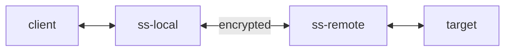

### OSI七层和TCP/IP四层的关系

1.1 OSI引入了服务、接口、协议、分层的概念，TCP/IP借鉴了OSI的这些概念建立TCP/IP模型。
1.2 OSI先有模型，后有协议，先有标准，后进行实践；而TCP/IP则相反，先有协议和应用再提出了模型，且是参照的OSI模型。
1.3 OSI是一种理论下的模型，而TCP/IP已被广泛使用，成为网络互联事实上的标准。
　　TCP：transmission control protocol 传输控制协议；  UDP：user data protocol 用户数据报协议
==OSI参考模型不是标准也不是协议，而是一个指定标准时所使用的概念框架。TCP/IP是OSI参考模型的实现。也就是说TCP/IP才是真正的实现。所以TCP/IP才是协议，**而OSI只是参考模型**==

|                   |              |                                         |
| ----------------- | ------------ | --------------------------------------- |
| OSI七层网络模型         | TCP/IP四层概念模型 | 对应网络协议                                  |
| 应用层（Application）  | 应用层          | HTTP、TFTP, FTP, NFS, WAIS、SMTP          |
| 表示层（Presentation） |              | Telnet, Rlogin, SNMP, Gopher            |
| 会话层（Session）      |              | SMTP, DNS                               |
| 传输层（Transport）    | 传输层          | TCP, UDP                                |
| 网络层（Network）      | 网络层          | IP, ICMP, ARP, RARP, AKP, UUCP          |
| 数据链路层（Data Link）  | 数据链路层        | FDDI, Ethernet, Arpanet, PDN, SLIP, PPP |
| 物理层（Physical）     | 物理层          | IEEE 802.1A, IEEE 802.2到IEEE 802.11     |

#### 应用层

最接近用户的一层，为应用程序提供网络服务接口，HTTP, HTTPS, FTP, SMTP, POP3, IMAP, DNS, DHCP, SNMP, Telnet, SSH (应用层协议)。
#### 表示层
数据格式转换、加密/解密、压缩/解压缩、字符编码。
SSL/TLS (加密在表示层实现，虽然通常被视为应用层协议的一部分)
#### 会话层
协调不同主机上应用程序之间的对话,管理对话模式（全双工、半双工）在数据传输中插入**同步点**，以便在通信中断后能够从某个点恢复，避免全部重传,控制谁在何时有权执行某些操作（在需要严格协调的应用中）。
#### 传输层（端口）
**端到端的可靠/不可靠传输**
**进程寻址(端口号)**：使用端口号(Port)标识主机上的具体应用程序或服务。
**分段与重组**：将上层应用数据分割成适合网络层传输的**段(Segment - TCP)** 或**数据报(Datagram - UDP)**，并在接收端重组。
**端到端的流量控制和拥塞控制**（主要针对TCP）。
#### 网络层（IP）
最重要的功能为IP寻址。分组/数据包(Packet/Datagram)、IP地址、路由器(Router)、路由协议（如RIP, OSPF, BGP）、ARP, ICMP。
**端到端的逻辑寻址和路由**：负责将数据包从源主机跨越多个网络（可能经过多个路由器）传送到目标主机。
**逻辑地址(IP地址)**：使用逻辑地址（如IP地址）标识网络上的主机。
**路由(Routing)**：确定数据包从源到目的地的最佳路径（路由选择算法）。
**分组(Packet)**：将传输层传来的数据段封装成**分组/数据报**（添加IP头，包含源/目的IP地址）。
**拥塞控制**：管理网络中的数据流量，避免网络过载（与传输层的端到端拥塞控制不同，网络层更多是局部控制）。
####  数据链路层(MAC地址)
数据链路层由来：单纯的电信号0和1没有任何意义，必须规定电信号多少位一组，每组什么意思
数据链路层的功能：定义了电信号的分组方式

该层主要负责建立和管理不同计算机节点间的数据链路，并提供差错检测、封装成帧、透明传输的能力。数据链路层又分为两个层：媒体访问控制子层（MAC）和逻辑链路控制子层（LLC）
#### 物理层
物理层的主要功能：**屏蔽物理媒介差异，为数据链路层提供统一的物理比特流传输能力。**
数据单元：比特
实例：光纤、网线、集线器、中继器、调制解调器等。
该层的主要作用是实现相邻计算机间的比特流传输，尽可能屏蔽掉具体传输介质和物理设备的差异

#### 数据封装与解封装
1. **发送方（从上到下 - 封装）：**
	- 应用层数据（如HTTP请求）交给表示层。
	- 表示层可能进行加密、压缩、格式转换，添加表示层头（PH）。
	- 交给会话层，会话层管理会话，添加会话层头（SH）。
	- 交给传输层，传输层分段（TCP/UDP），添加传输层头（TH - 包含源/目的端口号）。
	- 交给网络层，网络层封装成分组，添加网络层头（NH - 包含源/目的IP地址）。
	- 交给数据链路层，数据链路层封装成帧，添加帧头（FH - 包含源/目的MAC地址）和帧尾（FT - 如CRC）。
	- 交给物理层，物理层将帧转换成比特流，通过物理介质发送出去。
2. **接收方（从下到上 - 解封装）：**
	- 物理层收到比特流，转换成帧交给数据链路层。
	- 数据链路层检查帧尾（CRC），校验无误则去掉帧头和帧尾，将分组交给网络层；校验有错则可能丢弃或请求重传。
	- 网络层检查IP地址，如果是本机则去掉网络层头，将段交给传输层。
	- 传输层根据端口号确定目标应用程序，去掉传输层头，重组数据（如需要），将数据流交给会话层。
	- 会话层管理会话，去掉会话层头，将数据交给表示层。
	- 表示层进行解密、解压缩、格式转换，去掉表示层头，将原始应用数据交给应用层。
	- 应用层将数据交给目标应用程序处理。

![[20260527-193119_网络代理协议_78f7bd47ba9b.png]]

![[20260527-193143_网络代理协议_b5791e24c9ed.png]]


### 网络通信的基本流程
1. **DNS解析**
域名介绍
- **最右侧的点（.）**：代表根域名（Root Domain），通常省略不写（用户访问时浏览器自动补全）。
- **顶级域**：如 `.com`、`.org`、`.net` 或国家代码如 `.cn`、`.uk`。
- **二级域**：如 `example`，是用户可注册的主要部分。
- **子域名**：如 `www`、`mail`、`blog` 等，用户可自定义。
DNS解析过程:
浏览器查询本地缓存/本地host文件 → 递归DNS服务器 → 根域 → TLD服务器 → 权威DNS服务器。DNS 属于**应用层协议。** 这是在进行网络通信过程的第一步要进行的事

浏览器发送请求时全过程
> 发送一个DNS请求时先访问浏览器和本地缓存是否有域名对应IP地址=>查找本地host文件看看有没有添加映射关系=>请求发送到电脑本地的DNS服务器=>发送一个请求数据经过七层模型发出去其他服务器找IP

应用层请求，传输层加端口，网络层加IP，数据链路层加mac（ARP广播)，物理层传出到交换机，交换机只能解析两层到数据链路层，将数据包传到其挂载的路由器LAN口上，路由器NAT转换从WAN口发出，到其他路由器。

等到接受其他服务器数据时先经过路由器的NAT映射，路由器是个三层设备但通过NAT转换能获得到传输层即实现四层，更改数据包数据后发往内网。本机接受到所需IP后重新构建一个请求如“把首页内容发给我”


## 协议引入

### 划时代的shadowsocks协议
==What is Shadowsocks?==
Shadowsocks is a secure split proxy loosely based on [SOCKS5](https://tools.ietf.org/html/rfc1928).

The Shadowsocks local component (ss-local) acts like a traditional SOCKS5 server and provides proxy service to clients. It encrypts and forwards data streams and packets from the client to the Shadowsocks remote component (ss-remote), which decrypts and forwards to the target. Replies from target are similarly encrypted and relayed by ss-remote back to ss-local, which decrypts and eventually returns to the original client.

说明文档：https://shadowsocks.org/doc/what-is-shadowsocks.html
**shadowsocks已经能够被精准探测**
[[Shadowsocks 是如何被检测和封锁的]]
[[Shadowsocks是如何被检测和封锁的_2]]

安装shadowsocks-libev软件(使用 C 语言编写的shadowsocks)：
apt install shadowsocks-libev
查看shadowsocks状态：
systemctl status shadowsocks-libev.service
重启shadowsocks
systemctl restart shadowsocks-libev.service
编辑ss配置文件：
vim /etc/shadowsocks-libev/config.json
```json
{
    "server":"0.0.0.0",
    "mode":"tcp_and_udp",
    "server_port":8388,
    "local_port":1080,
    "password":"0ih6P782SZBC",
    "timeout":86400,
    "method":"chacha20-ietf-poly1305"
}
```
查看shadowsocks运行日志：
journalctl -u shadowsocks-libev.service -f

防火墙设置：
查看状态：ufw status
开放端口：ufw allow 8388
拒绝端口：ufw deny 8388
删除规则：ufw delete allow 8388
关闭防火墙：ufw disable
启动防火墙：ufw enable

查看cpu是否支持硬解aes：lscpu |grep aes

#### ss套插件用以防重放攻击
服务器安装插件
apt install shadowsocks-v2ray-plugin
查看内容
dpkg -L shadowsocks-v2ray-plugin
客户端安装插件
https://github.com/shadowsocks/shadowsocks-windows/releases/tag/4.4.1.0
https://github.com/shadowsocks/v2ray-plugin/releases/tag/v1.3.2
客户端：使用可以便捷添加插件这类外拓功能的软件如shadowrocks

![[20260526-203749_网络代理协议_cc6a6c6c37ea.png]]

服务端也要添加插件应有参数
```json
{
    "server":"0.0.0.0",
    "mode":"tcp_and_udp",
    "server_port":8388,
    "local_port":1080,
    "password":"0ih6P782SZBC",
    "timeout":86400,
    "method":"chacha20-ietf-poly1305",
    "plugin":"ss-v2ray-plugin",
    "plugin_opts":"server"
}
```


### 2.tls+trojan

https=http+tls `tls就是专门用来加密的`

非对称加密算法 公钥私钥 

tls过程只加密请求不会加密域名，因为一个服务器IP上可能有多个域名若加密服务器不能判断用哪个私钥解密。进行握手确认证书同时协商出一个对称式加密算法(尽管对数据加解密时使用的是非对称加密算法)，因为对称加密算法速度快，如果都使用非对称加密算法传输则时间会很慢

trojan服务器搭建，该服务器向证书颁发机构签证(也可以自签)。在电脑准备一个客户端Trojan来将流量伪装成https流量

`一个访问Google的请求先通过tls与谷歌握手拿到Google的证书加密(?)，然否该浏览器将请求交给Trojan客户端，同时trojan客户端与Trojan服务器握手拿到证书加密`

trojan搭建

服务器搭建使用trojango,在root目录下创建Trojan文件，再在Trojan目录下创建config.json配置文件

（trojan-go）[https://github.com/p4gefau1t/trojan-go](https://www.youtube.com/redirect?event=video_description&redir_token=QUFFLUhqbHptY19SS1VWTUF3MFlQMDFqNTZVZXVBZmU3Z3xBQ3Jtc0trc0plYklLazd0UkxQc0lid1hUdUw1VjZtM3FMQTdtb3ZfcEs5ZTNQWlpqeXhKTDBlMWNudFVqOWh4UzYxS1AzRWlsdFhXZ2VSRjNQYlRhWEZiRUI0VmdLTThwYWhJUVdCMjJyWE4tTEZmWkZITlJnQQ&q=https%3A%2F%2Fgithub.com%2Fp4gefau1t%2Ftrojan-go&v=gw2Vl1h89Wo) 

   trojan-go官方文档：[https://p4gefau1t.github.io/trojan-go/](https://www.youtube.com/redirect?event=video_description&redir_token=QUFFLUhqbEluWEVYcXM1MHlyWVB3VHdEZ2FSRkJTUWJoUXxBQ3Jtc0tuZmtjOUoyWFhseWVEUTRrYkV3Tm1IOGM0N0lVeVo5eE1SdzhxaFZET2tFWEJ3eXJwXzBleUZ6ZDRmcDZXRDJpQVBrOFk2alpxcEhvemRFbFdmay1weWtMQno5T25XQ1JVTEppYkVaeV81UDRtVC1HOA&q=https%3A%2F%2Fp4gefau1t.github.io%2Ftrojan-go%2F&v=gw2Vl1h89Wo)

**trojan配置文件：**

```
{
    "run_type": "server",
    "local_addr": "0.0.0.0",
    "local_port": 443,
    "remote_addr": "192.83.167.78",
    "remote_port": 80,
    "password": [
        "your_awesome_password"
    ],
    "ssl": {
        "cert": "server.crt",
        "key": "server.key"
    }
}
```

**申请证书：**

```
#安装acme：
curl https://get.acme.sh | sh
#安装socat：
apt install socat
#添加软链接：
ln -s  /root/.acme.sh/acme.sh /usr/local/bin/acme.sh
#注册账号： 
acme.sh --register-account -m my@example.com
#开放80端口：
ufw allow 80
#申请证书： 
acme.sh  --issue -d 替换为你的域名  --standalone -k ec-256
#安装证书： 
acme.sh --installcert -d 替换为你的域名 --ecc  --key-file   /root/trojan/server.key   --fullchain-file /root/trojan/server.crt 

#如果默认CA无法颁发，则可以切换下列CA：
#切换 Let’s Encrypt：
acme.sh --set-default-ca --server letsencrypt
#切换 Buypass：
acme.sh --set-default-ca --server buypass
#切换 ZeroSSL：
acme.sh --set-default-ca --server zerossl
```

**自签证书：**

```
#生成私钥：
openssl ecparam -genkey -name prime256v1 -out ca.key
#生成证书：
openssl req -new -x509 -days 36500 -key ca.key -out ca.crt  -subj "/CN=bing.com"
```

客户端添加


在无域名的情况下写不了申请信，可以自签证书

有个证书后使Trojan后台运行:

nohup ./trojan-go > trojan.log 2>&1 &

### 3.vmess+tcp(已淘汰)

用用户ID加加密方式先对传输数据加密，时间戳哈希对用户ID和加密方式加密，最后防火墙能看到的就只有时间戳和vpsIP,服务器会对比时间戳是否合理来认证是否通过

SSH连接工具（FinalShell）：[http://www.hostbuf.com/t/988.html](https://bulianglin.com/g/aHR0cDovL3d3dy5ob3N0YnVmLmNvbS90Lzk4OC5odG1s)
v2ray官方安装脚本：[https://github.com/v2fly/fhs-install-v2ray](https://bulianglin.com/g/aHR0cHM6Ly9naXRodWIuY29tL3YyZmx5L2Zocy1pbnN0YWxsLXYycmF5)

额外ID的作用：` `


**申请证书：**

```
#安装acme：
curl https://get.acme.sh | sh
#安装socat：
apt install socat
#添加软链接：
ln -s  /root/.acme.sh/acme.sh /usr/local/bin/acme.sh
#切换CA机构： 
acme.sh --set-default-ca --server letsencrypt
#申请证书： 
acme.sh  --issue -d 替换为你的域名 --standalone -k ec-256
#安装证书： 
acme.sh --installcert -d 替换为你的域名 --ecc  --key-file   /usr/local/etc/v2ray/server.key   --fullchain-file /usr/local/etc/v2ray/server.crt 
```

**vmess+tcp:**

```
{
  "inbounds": [
    {
      "port": 8388, 
      "protocol": "vmess",    
      "settings": {
        "clients": [
          {
            "id": "af41686b-cb85-494a-a554-eeaa1514bca7",  
            "alterId": 0
          }
        ]
      }
    }
  ],
  "outbounds": [
    {
      "protocol": "freedom",  
      "settings": {}
    }
  ]
}
```

这种方式和ss差不多都是无规则的字节流，故需要引入其他的协议加密

### 4.vmess+tcp+tls\vmess+ws+tls


注意tcp,tls等传输协议和传输安全是v2ray的功能，其他才是vmess协议的功能，vmess最原始的状态通常是vmess+tcp，协议还是原来的协议，但具体通过什么传输协议去承载vmess的流量是我们可以通过v2ray选择的

ws和tcp差不多，但vmess在https流量来时不能像Trojan一样跳转其他网站来伪装，故需要其他的方法来进行伪装

**vmess+tcp(ws)+tls:**

```
{
  "inbounds": [
    {
      "port": 8388, 
      "protocol": "vmess",    
      "settings": {
        "clients": [
          {
            "id": "af41686b-cb85-494a-a554-eeaa1514bca7",  
            "alterId": 0
          }
        ]
      },
      "streamSettings": {
        "network": "tcp",
        "security": "tls",
        "tlsSettings": {
          "certificates": [
            {
              "certificateFile": "/usr/local/etc/v2ray/server.crt", 
              "keyFile": "/usr/local/etc/v2ray/server.key" 
            }
          ]
        }
      }
    }
  ],
  "outbounds": [
    {
      "protocol": "freedom",
      "settings": {}
    }
  ]
}
```

### 5.vmess+ws+tls+web(稳定但臃肿且已被防火墙针对)

搭建网站的工具有非常多nginx，caddy,apache


之所以使用ws不用tcp的原因：

`网站搭建工具能识别ws协议内容，当使用ws时在nginx处该工具会将流量转发到v2ray服务端监听的端口上，如果使用tcp协议，到nginx时只剩请求和一个经过加密的加密方式和用户ID等信息`

只有当访问到了正确的路径后才会进入v2ray，只要nginx里面配置的和v2ray通信路径没有暴露那他的行为就和世界上其他搭建网站的行为是一样的，对比trojan有一个好处就是v2ray服务器不会直接与防火墙连接避免被检测到某些行为，当然trojan也可以配合nginx使用罢tls过程交给nginx处理，

客户端配置

**vmess+ws+tls+web:**

```
{
  "inbounds": [
    {
      "port": 8388,
      "listen":"127.0.0.1",
      "protocol": "vmess",
      "settings": {
        "clients": [
          {
            "id": "af41686b-cb85-494a-a554-eeaa1514bca7",
            "alterId": 0
          }
        ]
      },
      "streamSettings": {
        "network": "ws",
        "wsSettings": {
        "path": "/ray"
        }
      }
    }
  ],
  "outbounds": [
    {
      "protocol": "freedom",
      "settings": {}
    }
  ]
}
```

**nginx设置：**

```
#安装nginx：
apt install nginx
#重新加载nginx配置：
systemctl reload nginx.service
```


**nginx配置（替换http{}里的内容）：**

```
server {
   listen 443 ssl;
   listen [::]:443 ssl;

   server_name v.buliang0.tk;  #你的域名
   ssl_certificate       /usr/local/etc/v2ray/server.crt; 
   ssl_certificate_key   /usr/local/etc/v2ray/server.key;
   ssl_session_timeout 1d;
   ssl_session_cache shared:MozSSL:10m;
   ssl_session_tickets off;

   ssl_protocols         TLSv1.2 TLSv1.3;
   ssl_ciphers           ECDHE-ECDSA-AES128-GCM-SHA256:ECDHE-RSA-AES128-GCM-SHA256:ECDHE-ECDSA-AES256-GCM-SHA384:ECDHE-RSA-AES256-GCM-SHA384:ECDHE-ECDSA-CHACHA20-POLY1305:ECDHE-RSA-CHACHA20-POLY1305:DHE-RSA-AES128-GCM-SHA256:DHE-RSA-AES256-GCM-SHA384;
   ssl_prefer_server_ciphers off;
    
    location / {
        proxy_pass https://www.bing.com; #伪装网址
        proxy_ssl_server_name on;
        proxy_redirect off;
        sub_filter_once off;
        sub_filter "www.bing.com" $server_name;
        proxy_set_header Host "www.bing.com";
        proxy_set_header Referer $http_referer;
        proxy_set_header X-Real-IP $remote_addr;
        proxy_set_header User-Agent $http_user_agent;
        proxy_set_header X-Forwarded-For $proxy_add_x_forwarded_for;
        proxy_set_header X-Forwarded-Proto https;
        proxy_set_header Accept-Encoding "";
        proxy_set_header Accept-Language "zh-CN";
    }
    
    location /ray {
       proxy_redirect off;
       proxy_pass http://127.0.0.1:10000;
       proxy_http_version 1.1;
       proxy_set_header Upgrade $http_upgrade;
       proxy_set_header Connection "upgrade";
       proxy_set_header Host $host;
       proxy_set_header X-Real-IP $remote_addr;
       proxy_set_header X-Forwarded-For $proxy_add_x_forwarded_for;
   }
}

server {
    listen 80;
    server_name v.buliang0.tk;    #你的域名
    rewrite ^(.*)$ https://${server_name}$1 permanent;
}
```


### ss+xtls+回落

xtls也可以正常解析tls的流量

xray里面只有vless和trojan具有回落功能


1.客户端使用vless节点```浏览器发送请求经过tls握手先进行一次加密，将请求内容加密，传送到xray后经过vless协议使用xtls传输的安全方式进行加密，二次加密不包括第一次已经加密的内容可以节省不少性能


`数据包到达服务器时首先使用入站节点xless使用xtls对数据进行解析得到一个头部是vless的数据包，然后使用如下数据包帮我们传递请求`
2.客户端使用trojan节点

xtls可以正常解析tls流量，发现不是一个vless头部于是回落到Trojan入站点

3.一个正常的https流量即防火墙的重放攻击

经过两次回落到伪装网址

缺点：xtls是使用tls1.3加密的而大部分的网站现在都是使用tls1.2，可能导致在tls1.3里面包含1.2的流量特征可能被探测。

```
#关闭防火墙：ufw disable

#xray官方一键安装脚本：
bash -c "$(curl -L github.com/XTLS/Xray-install/raw/main/install-release.sh)" @ install -u root
#启动Xray：
systemctl start xray.service 
#重启Xray：
systemctl restart xray.service 
#Xray状态：
systemctl status xray.service
```

``` 
 申请证书：
 #安装acme： curl https://get.acme.sh| sh
 #安装socat：
 apt install socat
 #添加软链接：
 ln -s  /root/.acme.sh/acme.sh /usr/local/bin/acme.sh
 #切换CA机构：
 acme.sh --set-default-ca --server letsencrypt
 #申请证书： 
 acme.sh  --issue -d 替换为你的域名  --standalone -k ec-256
 #安装证书： 
 acme.sh --installcert -d 替换为你的域名 --ecc  --key-file   /usr/local/etc/xray/server.key   --fullchain-file /usr/local/etc/xray/server.crt 
```

```
xray配置文件：
{   "log": {
        "loglevel": "warning"
    },
    "inbounds": [
        {
            "port": 443,
            "protocol": "vless",
            "settings": {
                "clients": [
                    {
                        "id": "72bac1c4-02de-49b4-e498-fa8767638c23", 
                        "flow": "xtls-rprx-direct"
                    }
                ],
                "decryption": "none",
                "fallbacks": [
                    {
                        "dest": 8388
                    }
                ]
            },
            "streamSettings": {
                "network": "tcp",
                "security": "xtls",
                "xtlsSettings": {
                    "alpn": [
                        "http/1.1"
                    ],
                    "certificates": [
                        {
                            "certificateFile": "/usr/local/etc/xray/server.crt", 
                            "keyFile": "/usr/local/etc/xray/server.key"
                        }
                    ]
                }
            }
        },
        {
            "port": 8388,
            "listen": "127.0.0.1",
            "protocol": "trojan",
            "settings": {
                "clients": [
                    {
                        "password": "111"
                    }
                ],
                "fallbacks": [
                    {
                        "dest": "180.76.138.44:80"
                    }
                ]
            },
            "streamSettings": {
                "network": "tcp",
                "security": "none"
            }
        }
    ],
    "outbounds": [
        {
            "protocol": "freedom"
        }
    ]
}
```


# 节点提速

套用cloudflare提供的免费`CDN`以及`BBR`拥塞控制算法，并且通过配合`x-ui`面板实现`vless+ws+tls+web+cdn`的节点搭建

补充：x-ui图形化界面，其中内核是xray内核，路由跟踪：[https://tools.ipip.net/traceroute.php](https://bulianglin.com/g/aHR0cHM6Ly90b29scy5pcGlwLm5ldC90cmFjZXJvdXRlLnBocA)

在CF官网点击添加DNS添加记录套用CDN，数据传输到cdn时cdn服务器会先检查自己域名列表是否有这个域名，相当于一个中转的角色，但只能转发80端口和http协议的流量，ws协议是通过http升级来的，这也是要使用ws的原因，`CDN可以防止节点服务器被墙以及拯救被墙的服务器`,在cf配置时会默认分配一个cdn的IP可以使用优选IP来挑选IP，同时这个是没有套tls的虽然ws会进行一层伪装但这种情况比较危险。通过v2ray配置，将端口改为443即可因为https的流量默认走443端口。


```
x-ui面板：https://github.com/vaxilu/x-ui
CF优选IP：https://github.com/XIU2/CloudflareSpeedTest
CF官网：https://cloudflare.com
CF-CDN-IP段：https://www.cloudflare.com/zh-cn/ips/
```

```
# 安装nginx：
apt install nginx
# 配置nginx：
vim /etc/nginx/nginx.conf
# 重新加载nginx配置：
systemctl reload nginx.service
```

**nginx配置：**

```
user www-data;
worker_processes auto;
pid /run/nginx.pid;
include /etc/nginx/modules-enabled/*.conf;

events {
  worker_connections 768;
}

http {

 server {
    listen 80 default_server;
    listen [::]:80 default_server;

   ssl_protocols         TLSv1.2 TLSv1.3;
   ssl_ciphers           ECDHE-ECDSA-AES128-GCM-SHA256:ECDHE-RSA-AES128-GCM-SHA256:ECDHE-ECDSA-AES256-GCM-SHA384:ECDHE-RSA-AES256-GCM-SHA384:ECDHE-ECDSA-CHACHA20-POLY1305:ECDHE-RSA-CHACHA20-POLY1305:DHE-RSA-AES128-GCM-SHA256:DHE-RSA-AES256-GCM-SHA384;
   ssl_prefer_server_ciphers off;
location / {
  proxy_pass https://www.bing.com; #伪装网址
  proxy_ssl_server_name on;
  proxy_redirect off;
  sub_filter_once off;
  sub_filter "www.bing.com" $server_name;
  proxy_set_header Host "www.bing.com";
  proxy_set_header Referer $http_referer;
  proxy_set_header X-Real-IP $remote_addr;
  proxy_set_header User-Agent $http_user_agent;
  proxy_set_header X-Forwarded-For $proxy_add_x_forwarded_for;
  proxy_set_header X-Forwarded-Proto https;
  proxy_set_header Accept-Encoding "";
  proxy_set_header Accept-Language "zh-CN";
    }

   location /ray {
    proxy_redirect off;
    proxy_pass http://127.0.0.1:8388;
    proxy_http_version 1.1;
    proxy_set_header Upgrade $http_upgrade;
    proxy_set_header Connection "upgrade";
    proxy_set_header Host $host;
    proxy_set_header X-Real-IP $remote_addr;
    proxy_set_header X-Forwarded-For $proxy_add_x_forwarded_for;
    }

   location /xui {
    proxy_redirect off;
    proxy_pass http://127.0.0.1:9999;
    proxy_http_version 1.1;
    proxy_set_header Host $host;
   }
 }
}
```

**拥塞控制：**

```
#查询当前使用的 TCP 拥塞控制算法
sysctl net.ipv4.tcp_congestion_control
#查询当前Linux版本
uname -r

#启用BBR TCP拥塞控制算法
echo "net.core.default_qdisc=fq" >> /etc/sysctl.conf
echo "net.ipv4.tcp_congestion_control=bbr" >> /etc/sysctl.conf
sysctl -p
```


## VPS购买

美国CN2 GIA线路：[https://bwg.m123.org](https://bulianglin.com/g/aHR0cHM6Ly9id2cubTEyMy5vcmc)
香港CN2 GIA线路：[https://hk.m123.org](https://bulianglin.com/g/aHR0cHM6Ly9oay5tMTIzLm9yZw)
日本CN2 GIA线路：[https://jp.m123.org](https://bulianglin.com/g/aHR0cHM6Ly9qcC5tMTIzLm9yZw)
其他地区线路：[https://d.m123.org](https://bulianglin.com/g/aHR0cHM6Ly9kLm0xMjMub3Jn)

## 安装X-UI

```
bash <(curl -Ls https://raw.githubusercontent.com/FranzKafkaYu/x-ui/956bf85bbac978d56c0e319c5fac2d6db7df9564/install.sh) 0.3.4.4
```

## 搭建vision节点申请证书:

```
#安装证书工具：
curl https://get.acme.sh | sh; apt install socat -y || yum install socat -y; ~/.acme.sh/acme.sh --set-default-ca --server letsencrypt

#三种方式任选其中一种，申请失败则更换方式
#申请证书方式1： 
~/.acme.sh/acme.sh  --issue -d 你的域名 --standalone -k ec-256 --force --insecure
#申请证书方式2： 
~/.acme.sh/acme.sh --register-account -m "${RANDOM}@chacuo.net" --server buypass --force --insecure && ~/.acme.sh/acme.sh  --issue -d 你的域名 --standalone -k ec-256 --force --insecure --server buypass
#申请证书方式3： 
~/.acme.sh/acme.sh --register-account -m "${RANDOM}@chacuo.net" --server zerossl --force --insecure && ~/.acme.sh/acme.sh  --issue -d 你的域名 --standalone -k ec-256 --force --insecure --server zerossl

#安装证书：
~/.acme.sh/acme.sh --install-cert -d 你的域名 --ecc --key-file /etc/x-ui/server.key --fullchain-file /etc/x-ui/server.crt
```

## Reality寻找适合的目标网站

查询ASN：[https://tools.ipip.net/as.php](https://bulianglin.com/g/aHR0cHM6Ly90b29scy5pcGlwLm5ldC9hcy5waHA)

寻找目标：[https://fofa.info](https://bulianglin.com/g/aHR0cHM6Ly9mb2ZhLmluZm8)

```
asn=="25820" && country=="US" && port=="443" && cert!="Let's Encrypt" && cert.issuer!="ZeroSSL" && status_code="200"
```

## 检测端口是否被封

[https://tcp.ping.pe/](https://bulianglin.com/g/aHR0cHM6Ly90Y3AucGluZy5wZS8)

# 免费节点

google搜索`inurl:clash/proxies`查找免费节点，订阅地址转换网页https://github.com/tindy2013/subconverter/releases下载该实现本地订阅地址转换的工具，`https://github.com/tindy2013/subconverter/blob/master/README-cn.md工具的使用文档`运行时可以将本地作为后端服务器进行地址订阅转换https://acl4ssr-sub.github.io/进入该网页并配置好后端地址

节点测试工具https://bulianglin.com/archives/nodescatch.html，已集成订阅地址转换工具

clash for windows是一款较为臃肿的软件，它可以使用较为强大的分流策略，配置也较为复杂，其中配置文件包含大部分设置所以图形化界面基本可以做到不用设置，直接导入配置文件就能使用了，而且其节点列表也整合在整个配置文件中，所以对于分享节点链接也较为复杂，通常是直接分享整个配置文件，clash for windows的开发者基于内核的一个API接口搭建了WEB UI界面，但web页面无法直接操作电脑文件，即无法启动电脑中的clash内核，导致用户需要手动在命令栏启动内核再去web页面配置，


节点URL格式

```
trojan://aPKvmsIB@36.151.251.60:3754?type=tcp&sni=TG.WangCai2&allowInsecure=1#CN_youtube%40%E7%8B%AC%E7%AB%8B%E6%80%9D%E7%BB%B4_7B
ss://Y2hhY2hhMjAtaWV0Zi1wb2x5MTMwNTpOazlhc2dsRHpIemprdFZ6VGt2aGFB@arxfw2b78fi2q9hzylhn.freesocks.work:443#JP_youtube%40%E7%8B%AC%E7%AB%8B%E6%80%9D%E7%BB%B4
```

节点订阅格式

```
base64编码
```

clash节点列表格式

```
proxies:
  - {name: 日本高端线路24250, server: 24250.chats138.com, port: 41033, type: trojan, password: MTQ5MzAyOTI0NkBxcS5jb21xOWo5eHd4N2lhMjN0dGU=, udp: true}
  - {name: 韩国高端专线250315|02, server: 154814.app1688.top, port: 41034, type: trojan, password: MTQ5MzAyOTI0NkBxcS5jb21xOWo5eHd4N2lhMjN0dGU=, udp: true}
```

以文件格式保存的配置文件

```
yaml，txt文件
```

在测速软件中导入订阅(以集成本地订阅地址转换的工具)

```
可输入网页的直链
```


